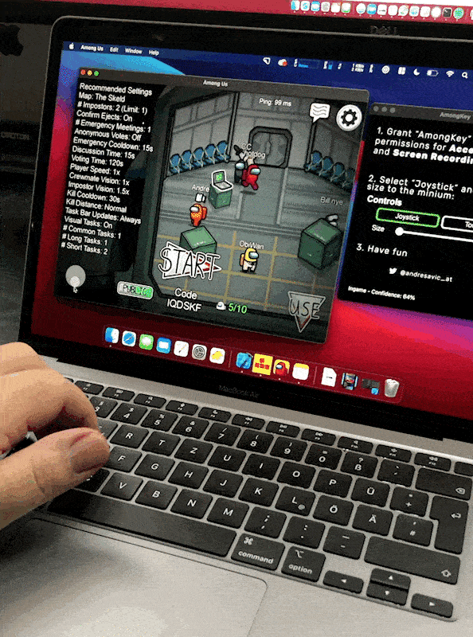

# AmongKey
Keyboard controls for Among Us on Apple Silicon Macs

## About The Project

Among Us got featured on the last Apple Event for the new Macs with Apple Silicon. Steve Jobs himself would turn in his grave if he knew how horrible the UX of Among Us is on M1 Macs. You can only control the game with touch👆🏼, but there are no touch screens on Mac. 

So I created AmongKey!  

AmongKey uses the Neural Engine of the M1 processor to recognize the current gamestate and translates keyboard input signals into mouse events matching the current situation. The ML model is trained on over 1300 screenshots of Among Us gameplays.

Yes, it is a hacky workaround(and a very funny side project)... but until the makers of Among Us will implement official keyboard support, you can enjoy Among Us like on a Window machine.

## Why ML for such a simple task?

Among Us is heavily based on the in-game chat during the game. So in one second you are runnning through the spaceship and in the next second you have to chat with your crewmates.
The chat on the Among Us mobile version is on the Mac even more broken, because you have to manually focus the inputfield and Return to send is not supported.

Keeping the keymapping static would be a very bad UX because the mouse cursor would always jump on the screen when you are typing(W A S D Space).

My first tries used simple color checking of specific UI elements. But after testing there was so many game situations in which this not worked out very well or the effort was way to large to catch all edge cases. For example specific tasks(security cameras) or emergency crisis tints the whole screen red. Even color values changed when changing the screen resolution.

After over 15 ML model generation and collecting(playing the game 🤓) a lot of training data the results are very reliable. Even for game situations that the model was not trained on. Just mindblowing. 🤯

## Requirements

- A Mac with Apple Silicon (the iPad version of Among Us from the Mac App Store runs on it).
- macOS 11 or newer (the deployment target). Developed and tested on **macOS 27.0.1** (fully updated at the time of writing); other versions were not tested.
- Two macOS permissions for AmongKey (see below): **Accessibility** and **Screen Recording**.

## Install and first-run setup

1. Download the app from the [releases page](https://github.com/andresavic/AmongKey/releases) or build it in Xcode (open `AmongKey.xcodeproj`, run).
2. Start AmongKey. macOS will ask for permissions. Grant both in *System Settings → Privacy & Security*:
   - **Accessibility** (labelled *Device Control and Data Access* on macOS 27): lets AmongKey see your key presses while Among Us is in front and send the mouse events.
   - **Screen & System Audio Recording**: lets AmongKey look at the Among Us window to work out which screen you are on (playing, lobby, chat, meeting). Only the Among Us window is read, and only while it is in front.
3. **Quit and reopen AmongKey** once both are on. macOS only applies a newly granted permission to a freshly started process.
4. Start Among Us and click into its window. The AmongKey window shows what it sees, e.g. `Ingame - Confidence: 94%`. If it says `Nothing` or `Menu` while you are in a match, one of the two permissions is missing.
5. Once it works you can untick **Show live detection (setup mode)** in the AmongKey window. It is only a setup aid, and leaving it off saves a little CPU. The choice is remembered.

If you build your own copy: macOS treats every re-signed build as a new app. If the toggles in System Settings look on but AmongKey reports no permission, remove the old *AmongKey* entries and grant again (or run
`tccutil reset Accessibility at.andresavic.AmongKey && tccutil reset ScreenCapture at.andresavic.AmongKey`).

## Controls

| Key | Action |
| --- | --- |
| `W` `A` `S` `D` or arrow keys | Move (joystick) |
| `Space` or `E` | Use |
| `R` | Report |
| `Q` | Kill |
| `V` | Vent |
| `F` | Role ability |
| `Tab` | Map while playing; open the chat in the lobby and in meetings (press again to close it) |
| `Return` | Send the chat message (only while the chat is open and has text in it) |
| `Esc` | Tap the *Tasks* tab |

## What changed in this update

Tested on an Apple M1 Mac on macOS 27.0.1. All changes are in `AmongKeyApp.swift`, `Keymapping.swift` and `ContentView.swift`; the model and the update check are untouched.

**Fixes**

- **The game window was never found on current macOS.** Its owner is named `AmongUs` (no space) there, while the code looked for `Among Us`, so nothing was ever detected.
- **Button positions were off** because the layout assumed a 4:3 game area. The game actually keeps a fixed 1.4317 shape and letterboxes it inside the window (1288 x 900 pt fullscreen on a 1440 x 900 screen, 919 x 642 pt in the default window), and the macOS 27 title bar is 32 pt, not 29. Positions are now fractions of that real game area. This fixes the joystick drifting off-direction and the shifted map, chat and Tasks buttons. See the comments at the top of `AmongKeyApp.swift` for how they were measured.
- Movement keys are released even if you leave the game while holding them, opening the window again no longer registers the key handlers twice, and typing digits in chat no longer triggers screenshot saving.
- Several force-unwraps in the window handling were replaced by safe checks.

**Chat and voting screen**

- While the chat is open or the voting screen is showing, the game keys (`W` `A` `S` `D`, `Space`, `Q`, `R`, ...) do nothing, so you can type freely and nothing clicks on top of the vote screen. Before, typing in the chat could close it, because the scene model (trained on an older look of these screens) read them as "in game" at 38-52 % confidence.
- Both screens are now recognised from the screenshot AmongKey already takes, with two cheap exact checks instead of the model: the chat button in the top row turns teal while the chat is open, and the voting screen's button row has a gap where gameplay has the notes button. The model is still used for everything else, and a confident "in game" reading is never overridden.
- `Return` sends with the real Send button (its old position pointed far below the chat panel) and puts the cursor back into the input box. `Tab` opens the chat and clicks into the input box once the panel has actually slid in, or closes it again if it is open. Both look at the screen at the moment of the key press instead of at a result that can be a check old.
- The window is tidied up: consistent text sizes and spacing, and the hint under the checkbox is no longer cut off.

**Lower CPU / power use** (it matters on laptops and on smaller Macs)

- The Core ML model is loaded once, and runs on the Neural Engine instead of the GPU the game is drawing on. It used to be loaded from disk on every check.
- Capturing and classifying happens on a background queue. It used to run on the main thread, which also handles key presses, so every check stalled input.
- Nothing runs while Among Us is not the front app. Window position and size are tracked with a cheap one-window query, and any move or resize recalibrates the click positions.
- The screen is only captured when something changed (window moved, a key that can change the scene, game came to the front) and about once per second when the scene is stable. A tiny thumbnail comparison skips the neural network when the picture is unchanged.
- Movement events are sent when the direction changes instead of 40 times per second, and the movement timer only exists while a movement key is held.

Measured on the M1 during practice mode (single 45 s runs, so treat as indicative): AmongKey itself averaged about 2% of one CPU core, and WindowServer averaged about 17%.

## Not re-verified yet

The layout was re-measured from screenshots of the in-game HUD, the meeting screen and the meeting chat (input box and Send button). The following are still assumptions and are marked `NOT measured` in the code. Screenshots (`Cmd+Shift+3`) of these screens are all that is needed to fix them:

- the lobby chat: its button (assumed to sit in the same slot as in meetings) and its panel (assumed to be the same panel as in meetings)
- Kill, Sabotage, Vent and role-ability buttons (impostor only)

## Developer notes

Developer mode is off unless the file `~/.amongkey_tune` exists when the app starts, so normal users pay nothing for it. When it exists:

- coordinates and timings are re-read every two seconds, so you can tune a running app without rebuilding (and re-granting the permissions). File format: `joyX joyY joyDist titlebar moveMode fastCheckSeconds slowCheckSeconds runBenchmark`, for example `0.0755 0.8911 0.055 32 1 0.35 0.75 0`.
- a log is written to `~/Library/Logs/AmongKey-debug.log` (scene changes, window geometry, key codes while Among Us is in front).
- `1`-`5` save a training screenshot into `~/Pictures/Training Data/<Ingame|Lobby|Lobbychat|Meeting|Menu>/` (create the folders first).
- setting the last value to `1` runs a one-off benchmark of the building blocks (window query, capture, classifier on Neural Engine / GPU / CPU) and writes it to the log.

On macOS 14+ Apple deprecated `CGWindowListCreateImage`, which AmongKey still uses for the capture. On the tested machine (macOS 27.0.1, Screen Recording granted) it still returns correct frames. A migration to ScreenCaptureKit is proposed in #37; the two changes touch the same area and should be easy to combine.

## Train the Machine Learning Model

Download the Trainig Data: 
https://drive.google.com/drive/folders/1VP8d5Rle5NWI-30EeXDdZ-mcO3Q3CSVI

Follow the instructions on:
https://developer.apple.com/documentation/createml/creating_an_image_classifier_model

## Thanks

Thanks to [varadarajjborkar/AmongKey](https://github.com/varadarajjborkar/AmongKey) for updating the app.
